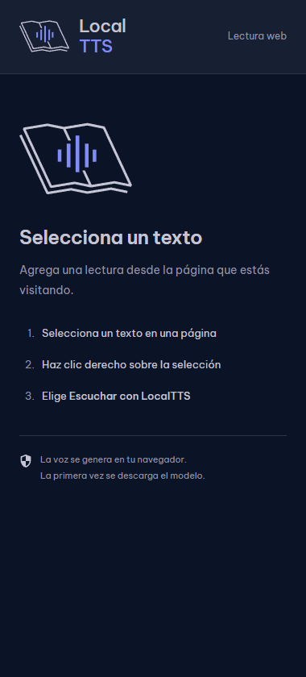
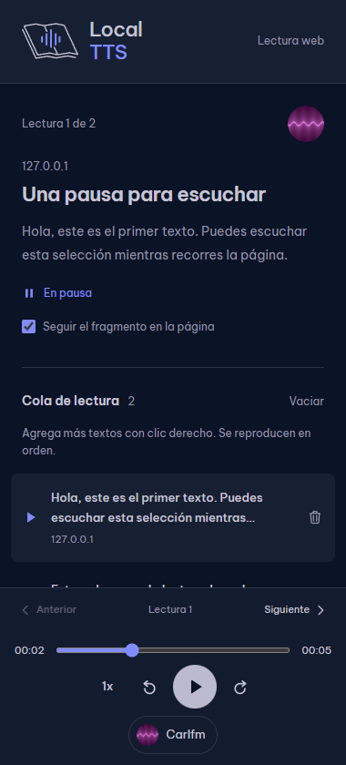
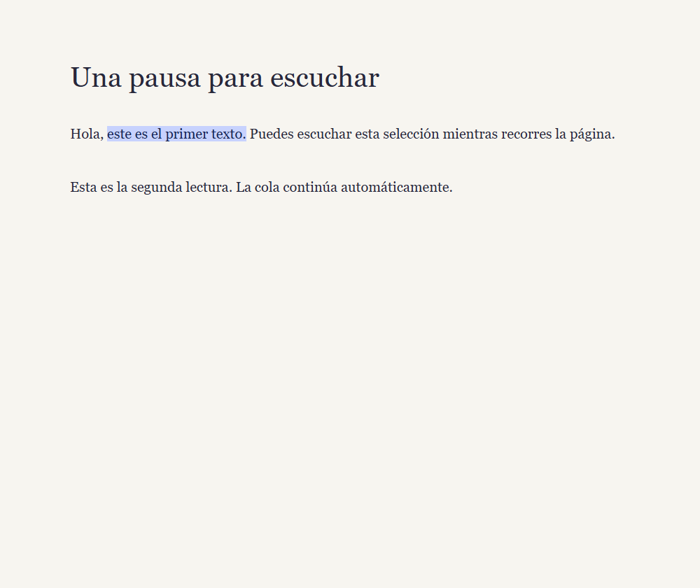
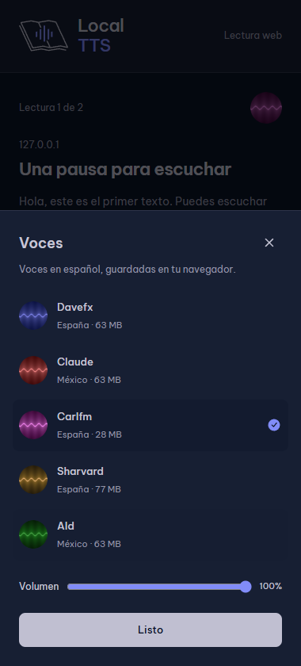

# Chrome extension

The Chrome extension is a separate Manifest V3 build in the same repository.
It uses LocalTTS's Piper worker, Spanish voice catalog, text chunker, WAV decoder,
audio-clock playback queue, playback controls and theme tokens.

## Build and install

Use Node 24.11.1 and pnpm 11.21.0, as specified by the repository.

```sh
pnpm install --frozen-lockfile
pnpm build:extension
```

1. Open `chrome://extensions` in Chrome 123 or newer.
2. Enable **Developer mode**.
3. Choose **Load unpacked** and select the generated `dist-extension` directory.
4. Select text on an HTTP/HTTPS page, right-click, and choose **Escuchar con LocalTTS**.
5. The native side panel opens and the first selection starts playing. Pin the extension
   icon to reopen its panel from the toolbar.

After rebuilding, reload the extension in Chrome and refresh source pages before
capturing new selections. The SPA's `pnpm build` output remains in `dist`.
The extension build is also checked in CI. No Firebase configuration is required.

## Queue and player

Each browser window has its own queue. New selections append without interrupting
the current reading. At completion, playback advances to the next selection.
Select an item directly or use **Anterior / Siguiente** to navigate. Playback remembers
the chunk and local offset when navigating or changing voices while the panel is open.
Removing the active item selects its successor, or its predecessor at the end.

The shared player supports pause/resume, replay, a seek slider, ±15 seconds, speed
from 0.5× to 2×, volume, and all five Spanish voices. The voice sheet opens from
the voice button. Pausing during voice preparation prevents automatic playback
when the first audio buffer arrives. A failed synthesis/decode stops the selection
with a retry message, rather than reporting a partial reading as complete.

Closing the panel stops audio, cancels pending synthesis, releases worker/audio
resources and removes the page highlight. Reopening retains the session queue
and restarts its active selection. Queue positions are retained only while the panel
is open; voice, speed, volume and follow-scroll preferences persist locally.

## Page highlighting

The content script captures live DOM ranges in the selected frame. The application's
chunker determines fragment boundaries. CSS Custom Highlights paints the active
range directly on the source page without inserting wrappers or rewriting page text.
Repeated phrases, partial selections, inline formatting, whitespace and paragraph
boundaries retain their original offsets. **Seguir el fragmento en la página** controls
automatic scrolling; disabling it leaves highlighting enabled.

Ranges are tied to the original document ID. Navigation, closed tabs, detached nodes
or changed text can make an anchor unavailable. Audio remains playable and the
panel explains the missing highlight. It does not search unrelated occurrences
to approximate a lost selection. Editable fields, PDF/canvas viewers, closed shadow
trees and cross-origin frames that Chrome denies cannot guarantee page highlighting.
Chrome's internal pages and the Web Store are outside this extension's capture flow.

## Permissions, storage and limits

The manifest requests `contextMenus`, `sidePanel`, `activeTab`, `scripting` and `storage`.
It has no broad host permission or always-running content script: capture is injected
into the selected frame after the context-menu action grants temporary page access.
The context-menu icon uses the existing LocalTTS branding.

Queue text is stored in `chrome.storage.session`, accessible only to trusted extension
contexts, with a key per window. Closing a window releases its queue and ranges.
Restarting the browser or reloading/updating the extension clears session storage.
The extension origin has its own voice cache and preferences, separate from the SPA.
Selection WAVs are kept for the current reading rather than stored as library books;
IndexedDB and the SPA's book/progress/OPFS schemas are unchanged. There is no login,
library sync or telemetry initialization in the extension.

Limits are 20,000 characters per selection, 30 queued selections and 120,000 total
queued characters. Rejections leave existing queue entries intact and display a
Spanish message. Only the active selection is synthesized.

JavaScript, ONNX runtime modules and Piper WASM/data are packaged from locked
dependencies. The CSP allows local WASM execution and forbids remote scripts.
Voice model/configuration files are downloaded on first use through the existing
streaming downloader and cached in OPFS. Model requests go to the upstream
Hugging Face voice repository and its delivery endpoints; processing text remains
local. The original Be Vietnam Pro font is bundled locally; no remote font is requested by the panel. See
[third-party notices](../extension/THIRD_PARTY_NOTICES.md) before redistribution.

## Verification

```sh
pnpm format:check
pnpm lint
pnpm build
pnpm build:extension
pnpm test
```

Offline tests cover queue limits/transitions, original DOM range mapping, trusted
message boundaries, synchronous panel opening before asynchronous capture, capture
fallbacks, worker cancellation, pause during preparation, and local-offset resumption, and recovery of empty model files left by an interrupted worker.

A Chromium smoke test with an unpacked extension and real CarlFM synthesis verified
WASM/audio playback, in-page highlights, appending while paused, automatic progression,
navigation/replay and cleanup after closing the panel, with no page JavaScript errors.
The fixture used a temporary localhost host permission to drive capture from the
test runner; the shipping manifest has no host permissions. The panel was opened
as an extension page for this automated smoke test. Native right-click menu interaction
and actual side-panel placement still need a manual Chrome check; unit tests verify
the click handler opens the panel in the user gesture before asynchronous work.
jsdom tests alone do not establish WASM/OPFS behavior or compatibility with every site.

| Empty panel                                           | Queue and player                                                       |
| ----------------------------------------------------- | ---------------------------------------------------------------------- |
|  |  |



The voice picker reuses the original voice portraits and SVG status icons:


